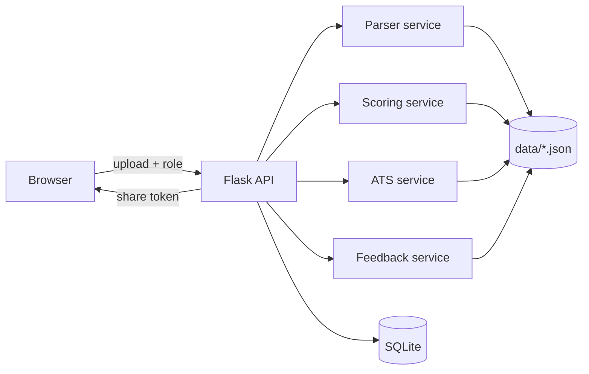

# Smart Resume Analyzer with AI-Based Feedback

An AI-powered web application that helps students analyze and improve their resumes. Upload a PDF or DOCX resume, pick a target job role (or paste a job description), and get a resume score out of 100, an ATS compatibility score, matched and missing skills, and prioritized improvement suggestions on an interactive dashboard.

All analysis is rule-based and deterministic: no external AI APIs, no model training, and every score comes with a reason.

**Live demo:** https://smart-resume-analyzer-4lji.onrender.com/
(Free hosting: the first visit after a period of inactivity can take about a minute to wake up.)

## Features

- **Resume upload:** PDF (`pdfplumber`) and DOCX (`python-docx`, including tables), validated on the server (type, real file signature, size, empty or unreadable files). Default limit is 5 MB, configurable.
- **Resume score (0-100):** seven weighted categories, each with the points earned and the reasons behind them.
- **ATS compatibility score (0-100):** keyword match, section headings, contact parsing, text extraction, layout risk and length, with a reason for every deduction.
- **Role-based skill matching:** nine roles, skill aliases (JS = JavaScript), plural and lemma matching with spaCy, and safe handling of short or symbol skills such as `R`, `Go`, `C++`, `.NET`. A pasted job description can be used instead of a role.
- **Smart feedback:** 20 declarative rules with priority, a "how to fix" and an example.
- **Dashboard:** score gauges with text labels, category chart, skill chips, expandable feedback cards, role switching without re-uploading, a private share link and a print-friendly view.
- **Config-driven:** roles, skills, weights and feedback rules live in JSON files under `data/`. Adding a role needs no code changes.

## Architecture



Workflow: upload, extract text, process, score, ATS keyword match, generate suggestions, display on the dashboard.

## Tech Stack

- **Backend:** Python, Flask 3.x, SQLAlchemy, SQLite
- **NLP and parsing:** spaCy (`en_core_web_sm`), `pdfplumber`, `python-docx`
- **Frontend:** HTML, Tailwind CSS (CDN), vanilla JavaScript, Chart.js
- **Testing and linting:** `pytest`, `ruff`
- **Deployment:** gunicorn on Render

Developed and deployed on Python 3.14.

## Quick Start

### 1. Environment setup

```bash
python -m venv .venv
# Windows PowerShell:
.\.venv\Scripts\Activate.ps1
# macOS/Linux:
source .venv/bin/activate

pip install -r requirements.txt
python -m spacy download en_core_web_sm
```

### 2. Run

```bash
python wsgi.py
```

Open `http://127.0.0.1:5000`. Debug mode is off unless you set `FLASK_DEBUG=1`.

### 3. Test and lint

```bash
pip install -r requirements-dev.txt
pytest
ruff check app tests wsgi.py
```

## Environment Variables

Copy `.env.example` to `.env` for local development.

| Variable | Purpose | Default |
|----------|---------|---------|
| `FLASK_DEBUG` | Set to `1` for development mode | `0` |
| `SECRET_KEY` | Flask secret key. Set a long random value in production | development value |
| `DATABASE_URL` | SQLAlchemy database URL | local SQLite file |
| `MAX_UPLOAD_MB` | Maximum upload size in MB | `5` |
| `PORT` | Port for `python wsgi.py` | `5000` |

## API Reference

### Infrastructure

| Method | Path | Description |
|--------|------|-------------|
| `GET` | `/health` | Health status and service version |
| `GET` | `/api/roles` | List the supported target roles |

### Resumes

| Method | Path | Description |
|--------|------|-------------|
| `POST` | `/api/upload` | Upload a PDF or DOCX resume; returns the resume ID, sections and contacts |
| `GET` | `/api/resumes/<id>` | Retrieve a parsed resume by ID |

### Scoring and ATS

| Method | Path | Description |
|--------|------|-------------|
| `POST` | `/api/score` | Resume score out of 100 with category breakdown |
| `POST` | `/api/ats` | ATS score and keyword match for a `role_id` or a `job_description` (not both) |

### Analysis

| Method | Path | Description |
|--------|------|-------------|
| `POST` | `/api/analyze` | Full pipeline: score, ATS, skills and suggestions. Saves the result and returns a `share_token` |
| `GET` | `/api/analysis/<share_token>` | Load a saved analysis (404 if unknown) |
| `GET` | `/api/history` | Paginated recent analyses without contact details (`?page=1&per_page=10`, max 50) |
| `GET` | `/result/<share_token>` | Dashboard page for a saved analysis |

### `POST /api/analyze`

Request body (JSON), with either a role or a job description:

```json
{"resume_id": 1, "role_id": "software_engineer"}
```

```json
{"resume_id": 1, "job_description": "We need a Python developer with..."}
```

Response (abridged):

```json
{
  "share_token": "...",
  "resume_id": 1,
  "role": "software_engineer",
  "resume_score": 72,
  "breakdown": {"structure": {"score": 17.5, "max_score": 20, "reasons": ["..."]}},
  "ats_score": 65,
  "ats_details": {"category_scores": {}, "deductions": []},
  "matched_skills": [],
  "missing_critical_skills": ["docker"],
  "missing_nice_to_have_skills": ["aws"],
  "keyword_match_percentage": 57.1,
  "suggestions": [
    {"id": "add_missing_critical_skills", "category": "Skills", "priority": "high",
     "message": "...", "how_to_fix": "...", "example": "..."}
  ]
}
```

### Error format

Every error uses the same JSON shape and a matching HTTP status. Stack traces go to the server log, never to the user.

```json
{"error": {"code": "NOT_FOUND", "message": "Analysis not found."}}
```

| Situation | Status |
|-----------|--------|
| Missing or invalid input, malformed JSON, unknown role, both role and job description sent | 400 |
| Unknown resume ID or share token, unknown route | 404 |
| Wrong HTTP method | 405 |
| File too large | 413 |
| Job description with no recognizable skills | 422 |

## Scoring Rubric

### Resume score (100 points)

Weights are defined in `data/scoring_config.json`.

| Category | Max | What is checked |
|----------|-----|-----------------|
| Structure | 20 | Essential and recommended sections, section organization |
| Skills | 20 | Size of the skills inventory, clean listing |
| Education | 15 | Degree, institution, grade or graduation timeframe |
| Projects | 15 | Structured entries, action verbs, repository or demo links |
| Experience | 10 | Experience section, quantified achievements |
| Contact | 10 | Email, phone, LinkedIn, GitHub |
| Completeness | 10 | Word count, bullet use, action-oriented language |

Freshers are not penalized for having no job history: projects and certifications count as substitutes.

### ATS score (100 points)

Weights are defined in `data/ats_config.json`.

| Criterion | Max |
|-----------|-----|
| Keyword match | 40 |
| Standard section headings | 20 |
| Parseable contact information | 15 |
| Text extraction quality | 10 |
| Layout and formatting risk | 10 |
| Length suitability | 5 |

## Feedback Engine

`app/services/feedback.py` evaluates the rules in `data/suggestions.json` against the computed score and ATS results.

- **Condition types:** `section_missing`, `section_present`, `no_contact_field`, `score_below`, `score_at_least`, `ats_score_at_least`, `word_count_below`, `word_count_above`, `action_verb_count_below`, `pronoun_count_above`, `bullet_count_below`, `no_quantified_metrics`, `ats_deduction_contains`, `compound_and`, `compound_or`.
- **Output:** sorted by priority (high, medium, low), de-duplicated by rule ID, capped at 12 suggestions.
- **Positive note:** `positive_strong_profile` appears when the resume score is at least 75 and the ATS score at least 70. It is added last and does not count toward the cap.
- **Adding rules:** edit `data/suggestions.json` only.

## Adding a New Role

1. Open `data/roles.json` and copy an existing role entry.
2. Change its ID and title, then edit the required skills (with weights), preferred skills, aliases and expected sections.
3. Restart the app. The role appears in the dropdown with no code changes.

## Deployment on Render

The app runs as a single Flask service that serves both the API and the pages.

1. Push the repository to GitHub.
2. In Render, choose **New, Web Service** and select the repository. Language: Python 3, instance type: Free.
3. Build command: `bash build.sh`
4. Start command: `gunicorn wsgi:app --workers 1 --threads 2 --bind 0.0.0.0:$PORT --timeout 120`
5. Add environment variables: `FLASK_DEBUG=0`, `DATABASE_URL=sqlite:////tmp/app.db`, `MAX_UPLOAD_MB=5`, and a long random `SECRET_KEY`.
6. Set the health check path to `/health`.
7. Create the service, wait for the build, then open `/health` and the home page.

The Python version comes from `.python-version`. `build.sh` installs the requirements and downloads the spaCy model. The database tables are created automatically on startup.

**Free-tier notes:** the disk is temporary, so saved analyses and share links can reset after a restart or redeploy. The service also sleeps after inactivity, so the first request can be slow.

## Project Structure

```
Capstone/
├── app/
│   ├── __init__.py          # App factory, error handlers, security headers
│   ├── config.py            # Configuration classes
│   ├── models.py            # SQLAlchemy models (Resume, Analysis)
│   ├── routes/
│   │   ├── api.py           # API routes
│   │   └── main.py          # Page routes
│   └── services/
│       ├── parser.py        # PDF/DOCX parsing, sections, contacts
│       ├── scoring.py       # Resume scoring engine
│       ├── ats.py           # Keyword matching and ATS score
│       └── feedback.py      # Feedback engine
├── data/                    # Configuration files
│   ├── roles.json
│   ├── skills.json
│   ├── sections.json
│   ├── scoring_config.json
│   ├── ats_config.json
│   └── suggestions.json
├── static/                  # JavaScript and CSS
├── templates/               # index.html, dashboard.html
├── tests/                   # pytest suite
├── build.sh                 # Render build script
├── render.yaml              # Render service definition
├── wsgi.py                  # Entry point
├── requirements.txt
├── requirements-dev.txt
├── ruff.toml
├── .python-version
├── .env.example
└── README.md
```

## Testing

The pytest suite (115 tests at the last run) covers upload validation, parsing, scoring, ATS matching, the feedback rules, the analysis flow and error handling. Tests check behavior rather than the output of a single sample resume.

```bash
pytest
```

## Limitations

- Keyword lists are static and cover nine roles.
- Matching is word-based and cannot judge the depth of a skill.
- Scanned (image-only) resumes cannot be read, and only English text is supported.
- Scores are heuristics, not predictions of how a real ATS or recruiter will rank a resume.
- No user accounts, and the free hosting tier can reset saved history.

## Future Work

- More roles, and an admin screen for editing skill lists
- OCR for scanned resumes and more languages
- Side-by-side comparison of several roles
- Score history for returning users after adding sign-in
